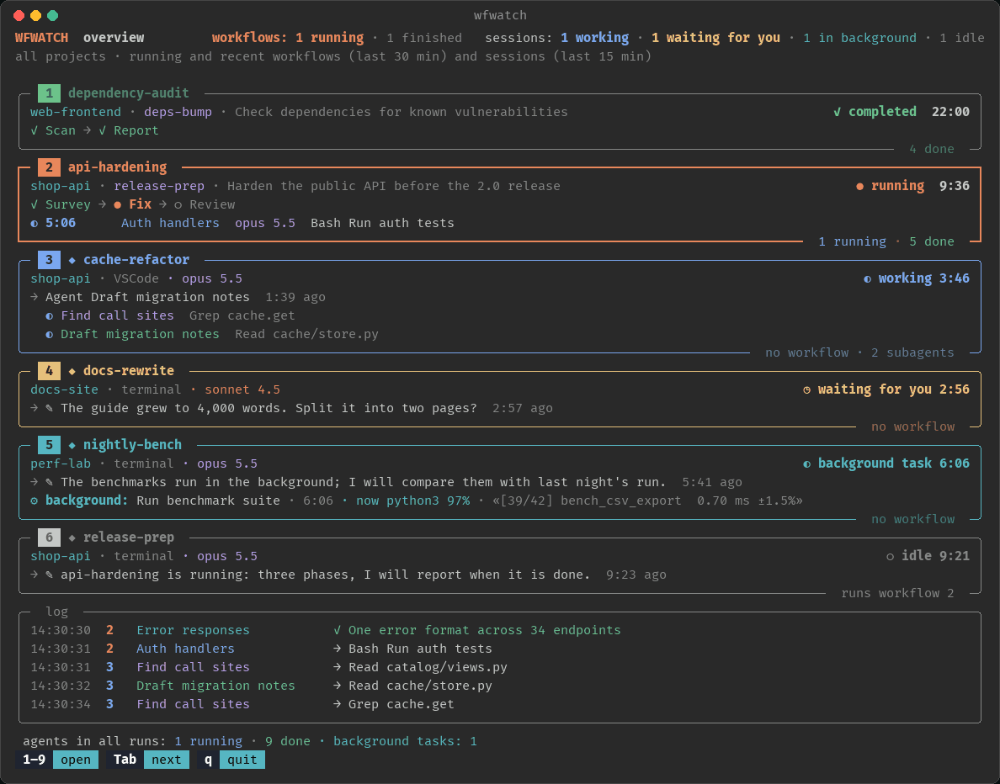
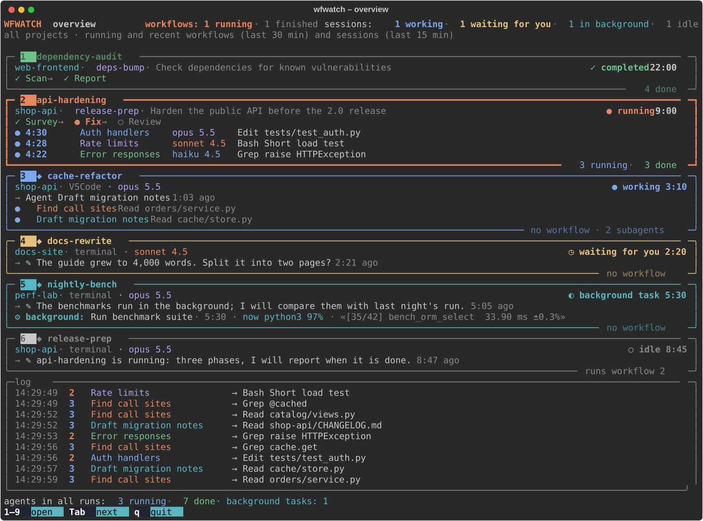
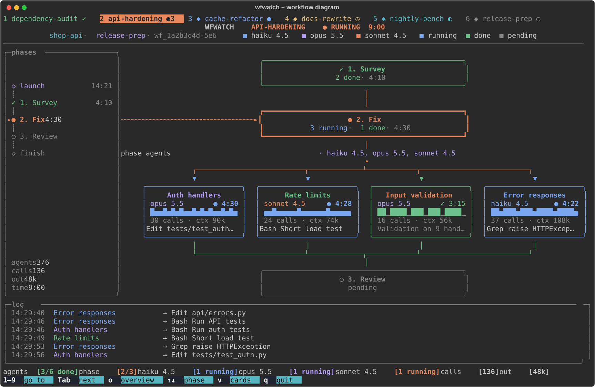
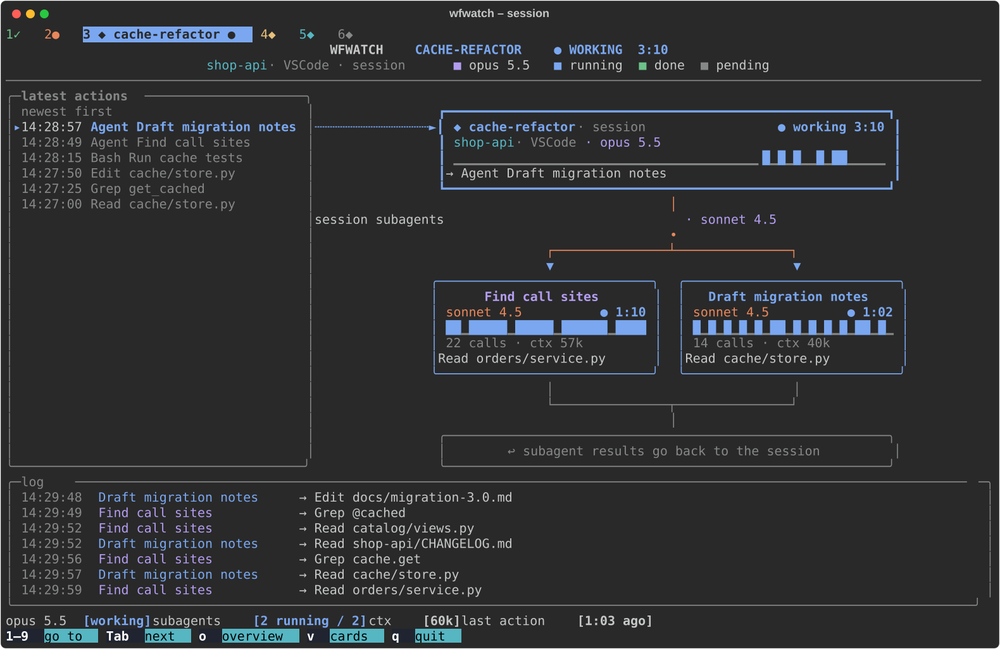

# wfwatch

[](https://github.com/zamirka/wfwatch/actions/workflows/ci.yml)
[](LICENSE)


A local terminal dashboard for **Claude Code, OpenAI Codex and OpenCode**: sessions across projects,
workflow phases, explicit plans, subagents, background commands and a shared activity log.

[Русская версия](README.ru.md)

Run wfwatch in a separate terminal next to your coding agents. It reads their existing local
history; no hooks, API keys or connection to a model provider are needed. It does not modify agent
sessions or stop their processes.



All screenshots use [synthetic demo data](#try-it-on-demo-data).

## Install and update

Requires Python 3.10+ and a UTF-8 terminal. macOS, Linux and native Windows are supported;
Windows Terminal is recommended on Windows. Process and CPU inspection is available on macOS/Linux.

With [uv](https://docs.astral.sh/uv/):

```sh
uv tool install git+https://github.com/zamirka/wfwatch
wfwatch --version
wfwatch
```

Update from the current `main` branch:

```sh
uv tool install --force --upgrade git+https://github.com/zamirka/wfwatch
```

Or use [pipx](https://pipx.pypa.io/):

```sh
pipx install git+https://github.com/zamirka/wfwatch
pipx reinstall wfwatch  # update an existing installation
```

To install a specific [release](https://github.com/zamirka/wfwatch/releases), append its tag to the
Git URL, for example `git+https://github.com/zamirka/wfwatch@v0.5.1`. A tag stays on that version;
install a newer tag explicitly to update. This README describes the current `main` branch.

Remove with `uv tool uninstall wfwatch` or `pipx uninstall wfwatch`.

## Quick start

```sh
wfwatch                              # live view; a single recent workflow may open directly
wfwatch --overview                   # always start with the overview
wfwatch --cards                      # detailed sessions/workflows as cards
wfwatch --once --overview --width 160 --lang en  # one snapshot, then exit
wfwatch --list                       # list Claude workflow runs
wfwatch wf_1a2b                      # explicitly select a workflow by ID or prefix
wfwatch hardening                    # select one by a substring of its script name
```

The live view needs an interactive terminal. Use `--once` for an agent to read a snapshot or for
output to a file/pipe. `python -m wfwatch` is equivalent to the executable.

An empty monitor stays empty. It does not automatically pin an old workflow from history.
A workflow explicitly selected on the command line stays selected, including historical runs.
`--list` lists Claude workflows, not all Codex/OpenCode sessions.

## What is supported

| Capability | Claude Code | Codex CLI/app | OpenCode |
|---|---|---|---|
| Sessions, model, recorded token usage, tool activity | Yes | Yes | Yes |
| Subagents and shared activity log | Yes | Nested threads | Child sessions |
| Workflow journals with phases and agent results | Yes | No | No |
| Explicit checklist rendered as stages | Workflow phases | `update_plan`, `plan_update`, optional companion | Experimental `todowrite` |
| Background commands, recorded output/completion | Yes | `exec_command`, `write_stdin`, code cells | Shell jobs and completion messages |
| Process, CPU and redirected output discovery | macOS/Linux | macOS/Linux | macOS/Linux |
| Exact approval/waiting state | Registry and history | Not reliably recorded | Running `question`, `plan`, `permission` tools |

A checklist is the agent's recorded plan. wfwatch does not invent steps from prose, assign a
subagent to a step without evidence, or mark a step complete just because the agent ended a turn.

### Plans and stages

Codex and OpenCode use the same phase-column layout as the Claude workflow view: recorded stages
on the left, the selected stage connected to the session block, completed stages marked ✓,
the current stage highlighted and pending stages dimmed. The overview shows completed/total steps
and the current step. Each child thread/session keeps its own plan.

The phase column needs at least 100 terminal columns. On narrower terminals the view is compact;
below 70 columns it falls back to cards. Press `v` for cards and use PgUp/PgDn to reach all items
of a long checklist. Workflow phases and session plans support manual selection with ↑/↓
and following the active stage with `f`.

**Codex:** native `update_plan` and `plan_update` records work automatically. If the tool is
unavailable, connect the optional companion skill:

```sh
wfwatch codex setup          # preview only
wfwatch codex setup --apply  # install after reviewing the changes
wfwatch codex status
```

Standard mode follows your existing authorization policy. To require agreement on a proposed plan
before any tools, including reads, explicitly choose `setup --require-approval --apply` instead.
Start a new Codex session. Ask the agent to record and update its plan using wfwatch-plan.
Instructions guide the agent; they do not technically block tools or authenticate consent.

After upgrading wfwatch, rerun setup to update the skill; without a mode flag it preserves your
choice. `wfwatch codex remove --apply` removes only managed integration content, preserving personal
instructions and plans. Preview, backups, conflicts, custom `CODEX_HOME`, commands and limitations
are described in [Codex setup](docs/codex-approved-plans.md). Package installation alone changes no
Codex settings. Missing plans show a hint; `p` opens help. Long diagram titles wrap; `p` also opens
the complete plan, with Up/Down and PgUp/PgDn scrolling, Escape to return. Restart the monitor after
upgrading. A textual plan in chat is not automatically converted into step statuses.

**OpenCode:** enable the experimental todo tool in your OpenCode config (merge this field into
`~/.config/opencode/opencode.json`; do not replace your providers or other settings):

```json
{
  "experimental": {
    "todo": true
  }
}
```

Then run `opencode reload`. The flag is documented in the
[OpenCode changelog](https://github.com/anomalyco/opencode/blob/dev/CHANGELOG.md).
A [project-level `experimental` object can override global options](https://github.com/anomalyco/opencode/issues/60410)
in affected OpenCode versions; ensure the effective config for your project retains `todo: true`.

Ask the agent to create a plan with **`todowrite`** and update `pending`, `in_progress` and
`completed` items as it works. Every call carries the full list. Cancelled items are omitted;
an empty list clears the plan. Enabling the flag makes the tool available; it does not force the
model to call it or create plans retroactively. Re-reading an older message does not replace a
newer checklist. The adapter was checked against OpenCode 2.3.0.

## Views and controls

### Overview



Workflows come first, followed by sessions (◆), with one shared numbering sequence. A block shows
project, model, status, recent action, current agents/background commands and plan progress when
available. The common log tags each event with its item's number. If space runs out, details fold,
then blocks become single lines; Tab still reaches items that do not fit.

### Workflow and session diagrams



Claude workflows show launch/finish, previous/current/next phases and their agents, recorded results,
tool-call rhythm, context and elapsed time. Superseded attempts are dimmed and excluded from totals.



A session without a plan shows recent actions on the left and its subagents fanned out below its
block. With a plan, the phase column replaces the recent-actions column; activity remains in the
log. Background commands have a separate block. Subagents shown under a session are not thereby
claimed to belong to its selected checklist step.

Cards (`v` or `--cards`) provide a scrollable alternative. Claude workflow phases with running
agents or errors expand automatically; `a` expands every phase. Session checklists are split into
scrollable sections so long plans remain accessible.

| Key | Action |
|---|---|
| `1`–`9`; two digits for 10+ | Open the numbered item |
| `o`, `0`, Esc | Return to overview |
| Tab / Shift+Tab, → / ← | Next / previous item |
| Enter | Open the first item from overview |
| ↑ / ↓ | Select a workflow/session plan stage; scroll cards or the full plan |
| `f` | Follow the current Claude workflow phase; reset session scroll |
| PgUp / PgDn, Home / End | Navigate plan stages, cards or the full plan |
| p / Esc | Open the full session plan or setup help / return |
| `v` | Switch diagram/cards |
| `a` | Expand all Claude workflow phases in cards |
| `q`, Ctrl+C | Quit |

The footer lists the available controls. Letter keys also work in the Russian keyboard layout.

### Status and retention

| Symbol | Meaning |
|---|---|
| ● | Running agent/phase or working session; animated in the live view |
| ✓ | Completed |
| ✗ | Failed |
| ⚠ | Interrupted or stale: completion is not known |
| ○ | Pending phase/step, or idle session |
| ◷ | Waiting for you |
| ◐ | Background work |
| ↺ | Superseded agent attempt |
| ■ | Killed workflow or closed owning session |

Finished Claude workflows stay in the overview for 30 minutes; idle sessions for 15 minutes.
Discovery generally tracks activity within three hours. Busy sessions with no meaningful activity
for an hour are hidden; waiting sessions have a three-hour cutoff. Verified Codex rollout writers
can keep active turns visible beyond that cutoff. These are observation rules, not proof a task
is hung or a measure of task completion.

Background tasks use recorded lifecycle events, output changes and available OS evidence. An
unchanged OpenCode `running` row is not a new heartbeat. Silent old tasks become stale without an
invented exit code; stale child jobs must not keep an idle root visible forever.

### Background commands

wfwatch shows the description/command, elapsed time, latest available output and recorded exit
status. On macOS/Linux it can associate a command with its process, show CPU usage and find a
redirected stdout/stderr file through OS file descriptors. Ambiguous matches are left unassigned;
a tool's session ID is never treated as an OS PID. A Claude registry-only background task can be
shown without command details when the transcript does not describe it.

Codex code-mode commands and yielded cells are tracked independently of the agent turn. Sequential
`text(await tools.exec_command(...))` / `write_stdin(...)` results can be matched across waits.
Arbitrary JavaScript is never executed by wfwatch or used to guess associations.

## Data sources and configuration

| Source | Default path / override | Data read |
|---|---|---|
| Claude Code | `~/.claude`, `CLAUDE_CONFIG_DIR` | Session registry, JSONL transcripts, workflow scripts/journals, subagent transcripts |
| Codex | `~/.codex/sessions`, `CODEX_HOME` | `rollout-*.jsonl`: turns, tools, tokens, plans, commands and thread ancestry |
| OpenCode | `~/.local/share/opencode/opencode.db`, `XDG_DATA_HOME` or `WFWATCH_OPENCODE_DB` | SQLite `project`, `session_v2`, `session_message`, `job` |
| Claude output | `/tmp/claude-<uid>/…/tasks/*.output` and permitted Claude roots | Last output line |
| OpenCode output | `<database directory>/shell/*/*.out` | Shell output |
| OS | `ps`; `lsof` on macOS, `/proc` on Linux | Process identity/tree, CPU and open files |

OpenCode SQLite is opened with `mode=ro`. Transcripts are read incrementally; OpenCode message
rows are re-read as they change in place. Polling is every 0.5 seconds; discovery/process refresh
is every 3 seconds. Internal storage formats can change between agent versions.

Use `--lang en` / `--lang ru`, or `WFWATCH_LANG`; otherwise the locale is used (English fallback).
`--theme auto|dark|light` controls colors; `auto` uses `COLORFGBG` when available. `NO_COLOR` disables
colors. `--width` sets snapshot/list width. `--debug` re-raises errors instead of displaying them.
`wfwatch --help` lists all options; `-n` limits `--list`, `--all` expands workflow cards.

## Try it on demo data

From a repository clone, generate synthetic Claude workflows/sessions and OpenCode sessions:

```sh
python3 scripts/demo_data.py /tmp/wfwatch-demo --live --opencode
```

In another terminal, isolate all readers from your real sessions:

```sh
CLAUDE_CONFIG_DIR=/tmp/wfwatch-demo \
CODEX_HOME=/tmp/wfwatch-demo/codex \
WFWATCH_OPENCODE_DB=/tmp/wfwatch-demo/opencode/opencode.db \
wfwatch --overview
```

The live Claude story runs for about two minutes; OpenCode fixtures are a static snapshot.
Without `--live`, the generator writes data and exits. Use `--lang ru` for Russian demo content.

## Limits and privacy

- Local sessions only. Web-only ChatGPT/Claude conversations and remote/container process state
  are outside coverage. Configure one root per supported source in each wfwatch process.
- Native Windows supports keyboard input and UTF-8 redirected output; OS process/CPU/redirected
  file discovery remains macOS/Linux-only. Known output files can still be read where available.
- Status, token counters and usage come from recorded data; they are not billing or progress
  guarantees. A quiet agent is not necessarily stuck. Codex approval state is not reliably recorded.
- Unknown OpenCode schemas are not guessed. Per-session read failures appear through the shared
  error handling; an unavailable/incompatible database can make its sessions disappear.
- wfwatch itself makes no network requests, uses no provider credentials and does not modify agent
  data. Installation downloads packages. Terminal output can contain private names, paths, commands,
  URLs and message excerpts; redact it before sharing. Output paths are checked before reading.

## Development

```sh
git clone https://github.com/zamirka/wfwatch
cd wfwatch
python3 -m venv .venv
.venv/bin/pip install -e '.[dev]'
.venv/bin/python -m wfwatch --overview
PYTHONWARNDEFAULTENCODING=1 .venv/bin/pytest -q -W error::EncodingWarning
.venv/bin/ruff check .
.venv/bin/ruff format --check .
```

On Windows, use `.venv\Scripts\python.exe` / `.venv\Scripts\pip.exe` instead of `.venv/bin/…`.
The encoding-warning environment-variable example above uses a POSIX shell.

`scripts/screenshots.py` renders the demo SVGs and GIF; install `.[demo]` for Pillow.
See [CONTRIBUTING.md](CONTRIBUTING.md), [CHANGELOG.md](CHANGELOG.md),
[the Codex audit](docs/codex-parity-audit.md) and [the OpenCode audit](docs/opencode-audit.md).
Audits record their dated scope; current code/tests and changelog describe subsequent changes.

## Disclaimer and license

An independent, unofficial project, not affiliated with or endorsed by Anthropic, OpenAI or
OpenCode's maintainers. Product names and trademarks belong to their owners. Agent storage formats
are internal and may change.

[MIT](LICENSE) © 2026 Zamir Musaev
