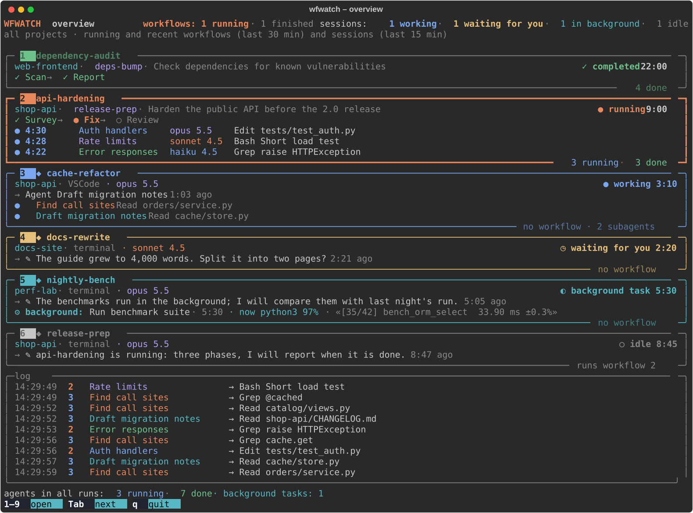

# wfwatch

[](https://github.com/zamirka/wfwatch/actions/workflows/ci.yml)
[](LICENSE)


A live terminal view of Claude Code [workflows](https://code.claude.com/docs/en/workflows),
[subagents](https://code.claude.com/docs/en/sub-agents) and sessions.

[Русская версия](README.ru.md)

A workflow runs dozens of agents in phases while your sessions keep working in other projects.
wfwatch shows all of it in a separate terminal: which workflows are running, which phase each one
is in and what every agent is doing right now, which sessions are working, waiting for your
answer or running a background command. It only reads the files Claude Code already writes, so it
never slows down or interrupts anything. Claude Code's own `/workflows` view shows the runs of a
session inside that session; wfwatch watches every session in every project at once.

wfwatch is an unofficial tool, not affiliated with or endorsed by Anthropic (see
[Disclaimer](#disclaimer)).


*All screenshots are made from [synthetic demo data](#try-it-on-demo-data).*

## Install

With [uv](https://docs.astral.sh/uv/):

```bash
uv tool install git+https://github.com/zamirka/wfwatch
```

or with [pipx](https://pipx.pypa.io/):

```bash
pipx install git+https://github.com/zamirka/wfwatch
```

To update: `uv tool upgrade wfwatch` or `pipx reinstall wfwatch`. To remove:
`uv tool uninstall wfwatch` or `pipx uninstall wfwatch`.

From a clone of the repository:

```bash
git clone https://github.com/zamirka/wfwatch
cd wfwatch
python3 -m venv .venv
.venv/bin/pip install -e .
.venv/bin/wfwatch --version
```

`python -m wfwatch` works too.

## Usage

Run it in a terminal of its own, next to Claude Code:

```bash
wfwatch              # everything that is going on; a single running workflow opens straight in its diagram
wfwatch -o           # start with the overview anyway
wfwatch --list       # recent runs: id, workflow, project, session, state, agents, time
wfwatch wf_1a2b      # one run, by its id or the beginning of it (stays on it)
wfwatch hardening    # one run, by a part of the workflow name
wfwatch -c           # the detailed view as cards instead of a diagram
wfwatch --once       # print one frame and exit
```

When no workflow and no session is active, wfwatch opens the most recent run. Unless a run was
given on the command line, the detailed view of a workflow moves on to a new run once the current
one has finished. `wfwatch --help` lists every option: `-n` (how many runs `--list` shows), `-a`
(cards: expand every phase), `--width` (for `--list` and `--once`), `--theme`, `--lang`,
`--debug`, `--version`.

### Keys

| Key | What it does |
|---|---|
| `1`–`9` | open the item with this number: workflows first, then sessions, as numbered in the overview. Two digits in a row open item 10 and above |
| `o`, `0`, Esc | back to the overview |
| Tab, → / Shift+Tab, ← | next / previous item |
| Enter | in the overview: open the first item |
| ↑ / ↓ | in a workflow: previous / next phase (the view stops following the running one); in the cards of a session: scroll |
| `f` | in a workflow: follow the running phase again |
| PgUp / PgDn, Home / End | in cards: scroll by a page, to the top, to the bottom |
| `v` | switch between the diagram and cards |
| `a` | in cards: expand every phase, or only the active ones |
| `q`, Ctrl+C | quit |

The bottom line of the screen lists the keys that work on the current screen, as in htop. Letter
keys also work in the Russian keyboard layout.

### Try it on demo data

No workflows of your own yet? The repository has a generator of synthetic data, with made-up
projects and sessions only:

```bash
python3 scripts/demo_data.py /tmp/wfwatch-demo --live   # keeps it going for about two minutes; Ctrl+C to stop
CLAUDE_CONFIG_DIR=/tmp/wfwatch-demo wfwatch             # in another terminal
```

Agents call tools and finish, the next phase starts, the workflow completes, a background command
prints its progress and ends. Without `--live` the script writes a still picture and exits.

## What you see

### Overview



A block for each workflow: project, session, state and time, the chain of phases and a line for
each running agent with its model and last action. Running workflows are shown, and finished ones
for 30 more minutes. Below come the sessions (marked ◆): project, VSCode or terminal, model, how
long the session has been in its state, its last action, its running subagents and background
commands. A session that runs a workflow is there too, with the number of its workflow. A session
waiting for your answer is yellow, an idle one is dim. Workflows and sessions are numbered in one
sequence, workflows first. At the bottom is a common log, each line tagged with the number of its
item.

A session is shown while it works, waits for you or runs a background command or agent, and for 15
minutes after it goes idle. The registry of sessions sometimes keeps a session "busy" long after it
has stopped, so a busy session whose history has been quiet for over an hour (a waiting one, for
over three hours) is left out.

When the terminal is too low for everything, agent lines go first, then blocks fold into one line
each, and at last a line says how many items are not shown (Tab reaches them).

### Workflow diagram


- At the top: the name, state and time, the project and the session, the colors of the models.
- On the left: the timeline from launch to finish, each phase with its time.
- In the middle: the previous phase, the current one and the next. The current phase fans out
  into agent cards; the ones that do not fit fold into a "+N more" card. Dots flow along the
  links: blue to running agents, green back from finished ones.
- An agent card: model, status and time, the rhythm of its tool calls over its life, the number
  of calls and the context size, its last action (for a finished agent, the first line of its
  result). An agent with no events for over three minutes is marked "silent".
- At the bottom: the log and a status line, for example
  `agents [3/6 done]   phase [2/3]   opus 5.5 [1 running]   calls [136]   out [48k]`. On a narrow
  terminal the running models fold into one item (`3 models [3 running]`), then calls and output go.

The phase column needs at least 100 columns; below 70 columns the cards replace the diagram. The
diagram adapts to the terminal, from 80x24 to large screens.

### Cards

`v` or `-c`: each phase as a panel of agent cards. Running phases, phases with errors and the
selected phase are expanded, the others take a line each (`a` expands them all). PgUp/PgDn scroll
when the phases do not fit. When the cards of a phase do not fit on the screen, the cards go to the
running agents first, then to the failed ones, and the others get a line each.

### Session


On the left, the latest actions of the session (newest first); in the middle, the session block:
state, model, rhythm of calls, last action or message. Its subagents fan out like the agents of a
workflow phase. Background commands, running and recently finished, have a block of their own.
At the bottom are the log of the session and its subagents and a status line:
`opus 5.5 [working]   subagents [2 running / 2]   ctx [60k]   last action [1:03 ago]`.

### Background commands

When a session starts a long command in the background (the Bash tool with `run_in_background`)
and goes quiet, it is not idle: wfwatch shows it as "◐ background task", with the command, how
long it has been running, the process it is running right now with its CPU load and the last line
of its output:

```
⚙ background: Run benchmark suite · 5:30 · now python3 97% · «[35/42] bench_orm_select  33.90 ms ±0.3%»
```

A command may send its output to a file of its own (`blender -b scene.blend -a > render.log 2>&1`),
and then the output file of Claude Code stays empty. wfwatch asks the system which file the
running process writes to and shows the last line of that file or of the output file, whichever
was written last. A finished command shows its exit code.

### States

| | Agent or phase | Workflow | Session |
|---|---|---|---|
| ● | running | running | working |
| ✓ | done | completed | |
| ✗ | failed | failed | |
| ⚠ | interrupted: the run ended or the session closed before the agent returned its result | | |
| ○ | pending, or never ran | | idle |
| ↺ | replaced by a later attempt after a resume (dimmed, not counted) | | |
| ■ | | killed, or its session was closed | |
| ◷ | | | waiting for you |
| ◐ | | | background task |

In the live view, what is running right now (an agent, a working session, a background command)
has a spinner ◐◓◑◒ in place of ●; a still frame (`--once`, the screenshots) shows ●.

There are no percentages: agents do not report them. Time, calls, the rhythm of calls and the last
action show how an agent is getting on.

## How it works

wfwatch reads the files Claude Code keeps under `CLAUDE_CONFIG_DIR` (`~/.claude` by default). Set
that variable to watch another directory.

| Source | What wfwatch takes from it |
|---|---|
| `projects/<project>/<session>.jsonl` | the session transcript: workflow launches and completion notices, background commands and agents, the session's own tool calls |
| `projects/<project>/<session>/subagents/workflows/<run>/journal.jsonl` | which agents of a run started, returned a result or failed |
| `projects/<project>/<session>/subagents/workflows/<run>/agent-<id>.jsonl` | an agent's transcript: tool calls, model, tokens |
| `projects/<project>/<session>/workflows/scripts/<name>-<run>.js` | the `meta` of the workflow script: name, description, phases |
| `projects/<project>/<session>/subagents/agent-*.jsonl` | ordinary subagents of a session |
| `sessions/<pid>.json` | running sessions: name, status, working directory, where the session is open |
| `/tmp/claude-<uid>/<project>/<session>/tasks/<task>.output` | the output of background commands (its last line) |
| `ps` | whether a session's process is alive, what its Bash tool is running right now |
| `lsof` (macOS), `/proc/<pid>/fd` (Linux) | the file a background command writes to instead of its output file (`> render.log`): its last line |

Transcripts are read incrementally: only the lines added since the last read, in chunks, so a long
history stays cheap. Files are re-read twice a second; the list of runs, the sessions and the
processes, every three seconds. Runs with activity in the last three hours are tracked.

## Requirements

- Python 3.10 or newer, macOS or Linux. On Windows, run wfwatch in WSL: the full-screen mode needs
  a POSIX terminal. Native Windows is not tested.
- A UTF-8 terminal with 256 colors or truecolor and a font with box-drawing characters.
- At least 100 columns for the full diagram with the phase column (80x24 works, with a compact
  layout).
- Claude Code. wfwatch was checked against Claude Code 2.1.311.

## Language and colors

The interface is in English or Russian: `--lang en|ru`, or the `WFWATCH_LANG` variable, or else
the locale (`LC_ALL`, `LC_MESSAGES`, `LANG`: `ru_*` means Russian). English is the default.

`--theme dark` suits a dark terminal background, `--theme light` a light one. The default, `auto`,
reads `COLORFGBG` (set by many terminals) and falls back to dark. Main text uses the terminal's own
foreground color. With `NO_COLOR` set, colors are dropped.

## Limitations

- wfwatch reads internal files of Claude Code. Their format is not documented and can change with
  any update. If something stops showing up after an update, please open an issue with the output
  of `wfwatch --version` and `claude --version`.
- Some states are inferred. An ordinary subagent counts as running while its transcript has changed
  in the last 90 seconds; a background one, until the notification of its end. A session is alive
  while its process is (checked by process id and start time), so sessions running in another
  container or on another machine that shares the directory look closed. A background command
  started before its session was restarted is shown as lost.
- Only this machine and one `CLAUDE_CONFIG_DIR` at a time.

## Privacy

Everything stays on your machine. wfwatch reads the files listed above and runs `ps` (and `lsof` on
macOS); it writes nothing, opens no network connections and sends nothing anywhere.

The screen does show what is in your transcripts: project and session names, file paths, commands,
search queries, URLs and the first lines of what agents write. Keep that in mind when you share
your screen or a screenshot. For a bug report, the demo data is a safe way to show a problem.

## Development

```bash
python3 -m venv .venv
.venv/bin/pip install -e '.[dev]'
.venv/bin/pytest -q
.venv/bin/ruff check . && .venv/bin/ruff format --check .
```

- `scripts/demo_data.py` writes the synthetic `CLAUDE_CONFIG_DIR` described above (`--help` for
  the options, `--lang ru` for Russian content).
- `scripts/screenshots.py` makes the pictures in `docs/` from that data: the SVG files with Rich,
  the GIF with Pillow (`.venv/bin/pip install -e '.[demo]'`, then
  `.venv/bin/python scripts/screenshots.py`). The clock and the process list are fixed, so with the
  same version of Rich the SVG files come out the same every time.

See [CONTRIBUTING.md](CONTRIBUTING.md) for the code style and how to report a problem without
sharing private data, and [CHANGELOG.md](CHANGELOG.md) for the changes.

## Disclaimer

wfwatch is an independent, unofficial project. It is not affiliated with, endorsed by or supported
by Anthropic. Claude and Claude Code are trademarks of Anthropic, PBC. wfwatch reads files that
Claude Code writes for its own use; their format may change with any Claude Code release.

## License

[MIT](LICENSE) © 2026 Zamir Musaev
