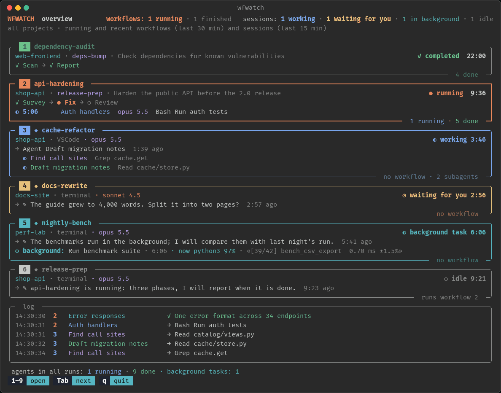
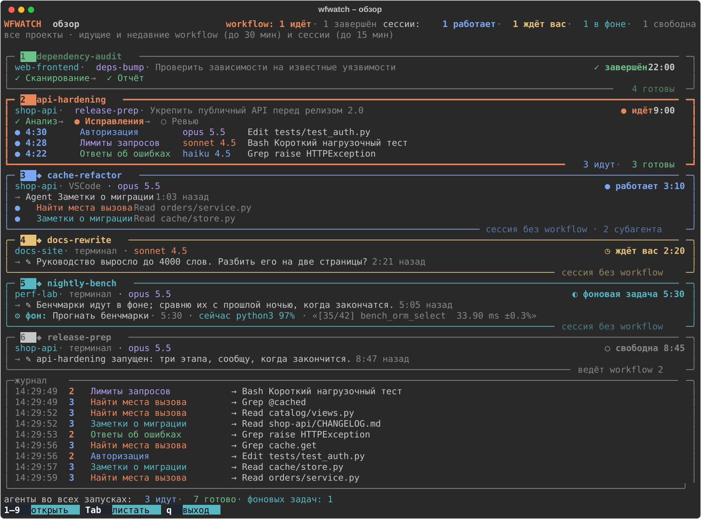
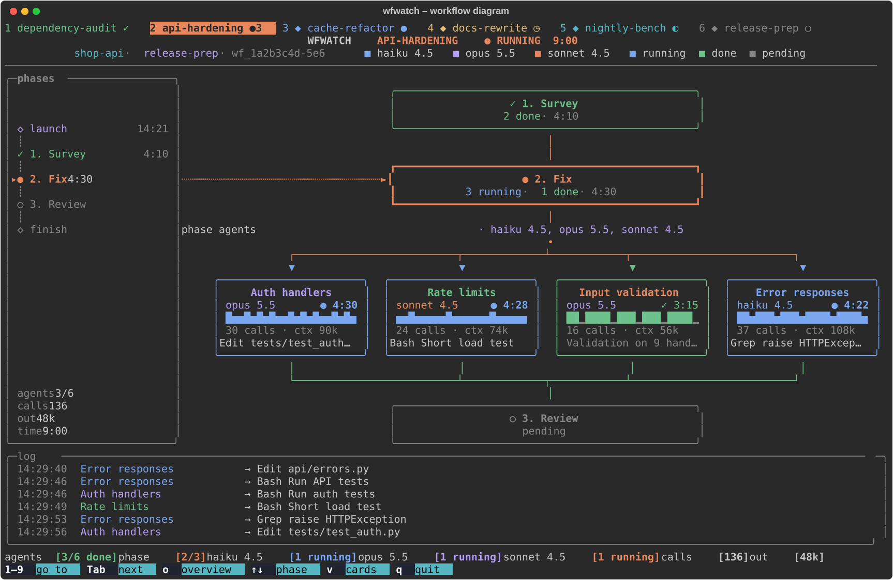
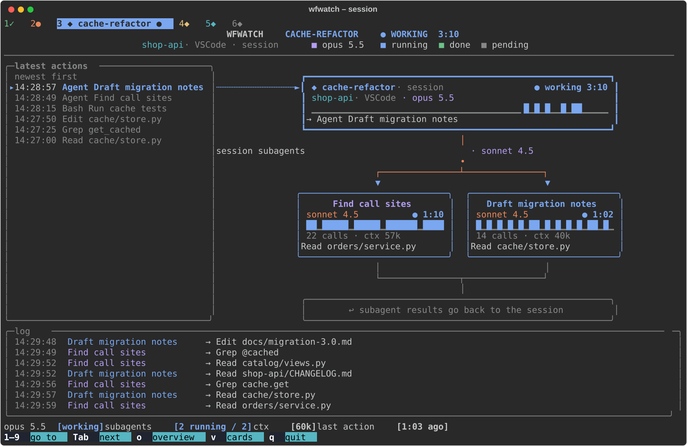

# wfwatch

[](https://github.com/zamirka/wfwatch/actions/workflows/ci.yml)
[](LICENSE)


Локальный терминальный монитор **Claude Code, OpenAI Codex и OpenCode**: сессии разных проектов,
этапы workflow, явные планы, субагенты, фоновые команды и общий журнал действий.

[English version](README.md)

Запустите wfwatch в отдельном терминале рядом с агентами. Он читает уже существующую локальную
историю. Хуки, API-ключи и подключение к провайдеру модели не нужны. Монитор не меняет сессии
агентов и не останавливает их процессы.



Все изображения сделаны на [синтетических демоданных](#попробовать-на-демоданных).

## Установка и обновление

Нужны Python 3.10+ и терминал с UTF-8. Поддерживаются macOS, Linux и нативная Windows;
в Windows рекомендуется Windows Terminal. Проверка процессов и CPU доступна в macOS/Linux.

Через [uv](https://docs.astral.sh/uv/):

```sh
uv tool install git+https://github.com/zamirka/wfwatch
wfwatch --version
wfwatch
```

Обновление из текущей ветки `main`:

```sh
uv tool install --force --upgrade git+https://github.com/zamirka/wfwatch
```

Либо через [pipx](https://pipx.pypa.io/):

```sh
pipx install git+https://github.com/zamirka/wfwatch
pipx reinstall wfwatch  # обновить существующую установку
```

Чтобы установить конкретный [релиз](https://github.com/zamirka/wfwatch/releases), добавьте тег к
Git URL, например `git+https://github.com/zamirka/wfwatch@v0.5.1`. Такая установка остаётся на
выбранной версии; для обновления явно укажите новый тег. README описывает текущую ветку `main`.

Удаление: `uv tool uninstall wfwatch` или `pipx uninstall wfwatch`.

## Быстрый старт

```sh
wfwatch                              # живой монитор; единственный недавний workflow может открыться сразу
wfwatch --overview                   # всегда начинать с общего обзора
wfwatch --cards                      # подробный вид карточками
wfwatch --once --overview --width 160 --lang ru  # один снимок и выход
wfwatch --list                       # список Claude workflow
wfwatch wf_1a2b                      # явно выбрать workflow по id или его началу
wfwatch hardening                    # выбрать по фрагменту имени скрипта workflow
```

Живому монитору нужен интерактивный терминал. Для чтения агентом, записи в файл или pipe
используйте `--once`. Вместо исполняемого файла можно вызвать `python -m wfwatch`.

Пустой монитор остаётся пустым: последний workflow из старой истории автоматически не
закрепляется. Явно выбранный в командной строке workflow остаётся выбранным, в том числе
исторический. `--list` перечисляет Claude workflow, а не все сессии Codex/OpenCode.

## Что поддерживается

| Возможность | Claude Code | Codex CLI/приложение | OpenCode |
|---|---|---|---|
| Сессии, модель, записанные токены, инструменты | Да | Да | Да |
| Субагенты и общий журнал | Да | Вложенные потоки | Дочерние сессии |
| Журналы workflow с фазами и результатами агентов | Да | Нет | Нет |
| Явный чек-лист в виде этапов | Фазы workflow | `update_plan`, `plan_update`, дополнительный скилл | Экспериментальный `todowrite` |
| Фоновые команды, записанный вывод и завершение | Да | `exec_command`, `write_stdin`, вычислительные ячейки | Shell jobs и сообщения о завершении |
| Поиск процесса, CPU и перенаправленного вывода | macOS/Linux | macOS/Linux | macOS/Linux |
| Точное ожидание разрешения или ответа | Реестр и история | Ненадёжно записывается | Работающие инструменты `question`, `plan`, `permission` |

Чек-лист – это записанный агентом план. wfwatch не придумывает этапы из обычного текста, не
приписывает субагента этапу без данных и не завершает пункт лишь потому, что агент закончил ответ.

### Планы и этапы

Для Codex и OpenCode используется та же колонка этапов, что и для Claude workflow: список слева,
выбранный этап связан с блоком сессии, завершённые отмечены ✓, текущий выделен, ожидающие
приглушены. В обзоре видны число завершённых пунктов и текущий этап. У дочерних потоков и сессий
свои планы.

Колонке этапов нужно не менее 100 символов ширины терминала. На меньшей ширине схема компактнее;
ниже 70 символов включаются карточки. Клавиша `v` переключает на карточки, PgUp/PgDn позволяют
дойти до всех пунктов длинного плана. Для фаз workflow и планов сессий доступны ручной
выбор ↑/↓ и возврат к текущему этапу клавишей `f`.

**Codex:** записи `update_plan` и `plan_update` читаются автоматически. Если инструмент
недоступен, подключите скилл по желанию:

```sh
wfwatch codex setup          # только показать изменения
wfwatch codex setup --apply  # установить после просмотра
wfwatch codex status
```

Обычный режим соблюдает существующие правила разрешений. Для обязательного согласования плана
перед любыми инструментами, включая чтение, явно выберите `setup --require-approval --apply`.
Начните новую сессию Codex и попросите вести план через wfwatch-plan. Инструкции направляют
поведение агента, но не блокируют инструменты технически и не удостоверяют согласие.

После обновления wfwatch повторите setup для обновления скилла; без флага режима ваш выбор
сохраняется. `wfwatch codex remove --apply` удаляет только управляемую интеграцию, сохраняя личные
инструкции и планы. Предпросмотр, резервные копии, конфликты, `CODEX_HOME`, команды и ограничения
описаны в [инструкции подключения](docs/codex-approved-plans.md). Установка самого пакета настройки
Codex не меняет. Если плана нет, показывается подсказка; `p` открывает помощь. Длинные названия
в диаграмме переносятся на несколько строк. `p` открывает полный план, ↑/↓ и PgUp/PgDn прокручивают
текст, Esc возвращает назад. После обновления перезапустите монитор. План из обычного текста
переписки автоматически не превращается в статусы этапов.

**OpenCode:** включите экспериментальный инструмент в конфиге OpenCode. Добавьте поле в
`~/.config/opencode/opencode.json`, сохранив провайдеры и остальные настройки:

```json
{
  "experimental": {
    "todo": true
  }
}
```

Примените через `opencode reload`. Флаг описан в
[changelog OpenCode](https://github.com/anomalyco/opencode/blob/dev/CHANGELOG.md).
В затронутых версиях OpenCode [проектный объект `experimental` может перекрывать глобальные
настройки](https://github.com/anomalyco/opencode/issues/60410). Проверьте, что для вашего проекта остаётся `todo: true`.

Попросите агента создать план инструментом **`todowrite`** и обновлять статусы `pending`,
`in_progress`, `completed` по мере работы. Каждый вызов передаёт полный список. Отменённые
пункты не показываются; пустой список очищает план. Флаг делает инструмент доступным, но не
заставляет модель вызывать его и не создаёт планы задним числом. Повторное чтение старого
сообщения не заменяет более новый чек-лист. Адаптер проверялся на OpenCode 2.3.0.

## Экраны и управление

### Общий обзор



Сначала идут workflow, затем сессии (◆), с общей нумерацией. В блоке видны проект, модель,
состояние, последнее действие, активные агенты и фоновые команды, прогресс записанного плана.
Общий журнал помечает события номером соответствующего элемента. Если места не хватает,
сначала скрываются детали, затем блоки сворачиваются до одной строки. Tab позволяет дойти
и до тех элементов, которые не поместились.

### Схемы workflow и сессий



Claude workflow показывает запуск и финиш, предыдущую, текущую и следующую фазы с агентами,
записанные результаты, ритм вызовов, контекст и время. Заменённые попытки приглушены и не
учитываются в итоговых счётчиках.



У сессии без плана слева показаны последние действия, а под её блоком – субагенты. При наличии
плана вместо колонки действий появляются этапы; действия остаются в журнале. У фоновых команд
отдельный блок. Субагенты под блоком сессии не считаются автоматически исполнителями выбранного
пункта чек-листа.

Карточки (`v` или `--cards`) – вариант с прокруткой. У Claude workflow автоматически раскрываются
фазы с работающими агентами и ошибками; `a` раскрывает все. Чек-лист сессии разбивается на
секции, поэтому длинный план можно просмотреть целиком.

| Клавиша | Действие |
|---|---|
| `1`–`9`; две цифры для 10+ | Открыть элемент по номеру |
| `o`, `0`, Esc | Вернуться в обзор |
| Tab / Shift+Tab, → / ← | Следующий / предыдущий элемент |
| Enter | Открыть первый элемент из обзора |
| ↑ / ↓ | Выбрать этап workflow или плана сессии; прокрутить карточки или полный план |
| `f` | Следовать текущей фазе Claude workflow; сбросить прокрутку сессии |
| PgUp / PgDn, Home / End | Перемещаться по этапам, карточкам или полному плану |
| p / Esc | Открыть полный план или помощь подключения / вернуться |
| `v` | Переключить схему и карточки |
| `a` | Раскрыть все фазы Claude workflow в карточках |
| `q`, Ctrl+C | Выйти |

Подсказки доступных клавиш находятся внизу экрана. Буквенные клавиши работают и в русской раскладке.

### Состояния и сроки отображения

| Символ | Значение |
|---|---|
| ● | Работающий агент, фаза или сессия; в живом виде анимируется |
| ✓ | Завершено |
| ✗ | Ошибка |
| ⚠ | Прервано или потеряно наблюдение; завершение неизвестно |
| ○ | Ожидающая фаза/пункт плана либо неактивная сессия |
| ◷ | Ожидание вашего ответа |
| ◐ | Фоновая работа |
| ↺ | Заменённая попытка агента |
| ■ | Остановленный workflow или закрытая сессия-владелец |

Завершённые Claude workflow остаются в обзоре 30 минут, неактивные сессии – 15 минут.
Обычно обнаружение охватывает активность последних трёх часов. Работающие сессии без значимых
событий час скрываются; для ожидающих ответа порог – три часа. Подтверждённый процесс записи
rollout Codex может сохранять видимость активного хода дольше этого порога. Это правила наблюдения,
а не доказательство зависания или измерение готовности задачи.

Фоновые задачи используют записанные события запуска/завершения, изменения вывода и доступные
данные ОС. Неизменившаяся строка OpenCode `running` не считается новым сигналом активности.
Старые молчащие задачи становятся устаревшими без выдуманного кода выхода; устаревшие jobs
субагентов не должны бесконечно удерживать неактивную корневую сессию.

### Фоновые команды

Показываются описание или команда, время, последний доступный вывод и записанный результат
завершения. В macOS/Linux монитор может сопоставить команду с процессом, показать CPU и найти
файл перенаправленного stdout/stderr по файловым дескрипторам ОС. Неоднозначные совпадения
не используются; id сессии инструмента никогда не считается PID процесса. Фоновая задача Claude,
известная только реестру, может показываться без деталей команды.

Команды Codex в code mode и приостановленные ячейки отслеживаются независимо от хода агента.
Результаты последовательных `text(await tools.exec_command(...))` / `write_stdin(...)`
сопоставляются в том числе через ожидание ячеек. wfwatch никогда не исполняет произвольный
JavaScript и не угадывает связи на его основе.

## Источники данных и настройки

| Источник | Путь по умолчанию / переопределение | Что читается |
|---|---|---|
| Claude Code | `~/.claude`, `CLAUDE_CONFIG_DIR` | Реестр сессий, JSONL-история, скрипты и журналы workflow, история субагентов |
| Codex | `~/.codex/sessions`, `CODEX_HOME` | `rollout-*.jsonl`: ходы, инструменты, токены, планы, команды и связи потоков |
| OpenCode | `~/.local/share/opencode/opencode.db`, `XDG_DATA_HOME` или `WFWATCH_OPENCODE_DB` | SQLite `project`, `session_v2`, `session_message`, `job` |
| Вывод Claude | `/tmp/claude-<uid>/…/tasks/*.output` и разрешённые каталоги Claude | Последняя строка вывода |
| Вывод OpenCode | `<каталог базы>/shell/*/*.out` | Вывод shell |
| ОС | `ps`; `lsof` в macOS, `/proc` в Linux | Идентичность и дерево процессов, CPU, открытые файлы |

SQLite OpenCode открывается с `mode=ro`. История читается инкрементально; строки сообщений
OpenCode перечитываются по мере изменения на месте. Опрос идёт каждые 0,5 секунды, обновление
списка сессий и процессов – каждые 3 секунды. Внутренние форматы могут меняться между версиями агентов.

Язык: `--lang en` / `--lang ru` либо `WFWATCH_LANG`; иначе используется локаль, с английским
как запасным вариантом. Цвета: `--theme auto|dark|light`; `auto` учитывает `COLORFGBG`, если он задан.
`NO_COLOR` отключает цвета. `--width` задаёт ширину снимка/списка. `--debug` пробрасывает ошибки
вместо их отображения. Все параметры перечислены в `wfwatch --help`; `-n` ограничивает `--list`,
`--all` раскрывает карточки фаз workflow.

## Попробовать на демоданных

Из клона репозитория создайте синтетические Claude workflow/сессии и сессии OpenCode:

```sh
python3 scripts/demo_data.py /tmp/wfwatch-demo --live --opencode
```

В другом терминале изолируйте все источники от настоящих сессий:

```sh
CLAUDE_CONFIG_DIR=/tmp/wfwatch-demo \
CODEX_HOME=/tmp/wfwatch-demo/codex \
WFWATCH_OPENCODE_DB=/tmp/wfwatch-demo/opencode/opencode.db \
wfwatch --overview
```

Живая история Claude идёт около двух минут; данные OpenCode – статичный снимок. Без `--live`
генератор записывает данные и выходит. `--lang ru` включает русские тексты демоданных.

## Ограничения и приватность

- Только локальные сессии. Веб-диалоги ChatGPT/Claude и состояние процессов на другой машине
  или в контейнере не отслеживаются. Для каждого источника задаётся один корневой каталог на
  процесс wfwatch.
- Нативная Windows поддерживает клавиатуру и UTF-8 при перенаправлении вывода. Поиск процессов,
  CPU и перенаправленных файлов доступен только в macOS/Linux. Известные файлы вывода могут
  читаться и без такого поиска.
- Статусы, токены и использование берутся из записанных данных. Это не гарантия биллинга или
  готовности задачи. Молчащий агент не обязательно завис; ожидание разрешений Codex ненадёжно
  отражается в журнале.
- Неизвестные схемы OpenCode не угадываются. Ошибки чтения сессий проходят через общий механизм
  ошибок; недоступная или несовместимая база может привести к исчезновению её сессий.
- Сам wfwatch не делает сетевых запросов, не использует ключи провайдеров и не меняет данные
  агентов. При установке скачиваются пакеты. На экране могут быть частные названия, пути, команды,
  URL и фрагменты сообщений; удаляйте их перед публикацией. Пути вывода проверяются до чтения.

## Разработка

```sh
git clone https://github.com/zamirka/wfwatch
cd wfwatch
python3 -m venv .venv
.venv/bin/pip install -e '.[dev]'
.venv/bin/python -m wfwatch --overview
PYTHONWARNDEFAULTENCODING=1 .venv/bin/pytest -q -W error::EncodingWarning
.venv/bin/ruff check .
.venv/bin/ruff format --check .
```

В Windows используйте `.venv\Scripts\python.exe` / `.venv\Scripts\pip.exe` вместо `.venv/bin/…`.
Пример с переменной окружения для проверки кодировок выше использует POSIX-синтаксис оболочки.

`scripts/screenshots.py` создаёт SVG и GIF из демоданных; для Pillow установите `.[demo]`.
Дополнительно: [CONTRIBUTING.md](CONTRIBUTING.md), [CHANGELOG.md](CHANGELOG.md),
[аудит Codex](docs/codex-parity-audit.md), [аудит OpenCode](docs/opencode-audit.md).
Аудиты фиксируют состояние на указанную дату; последующие изменения описаны кодом, тестами и changelog.

## Оговорка и лицензия

Независимый неофициальный проект. Он не связан с Anthropic, OpenAI или разработчиками OpenCode
и не одобрен ими. Названия продуктов и товарные знаки принадлежат их владельцам. Форматы
хранения агентов внутренние и могут меняться.

[MIT](LICENSE) © 2026 Zamir Musaev
