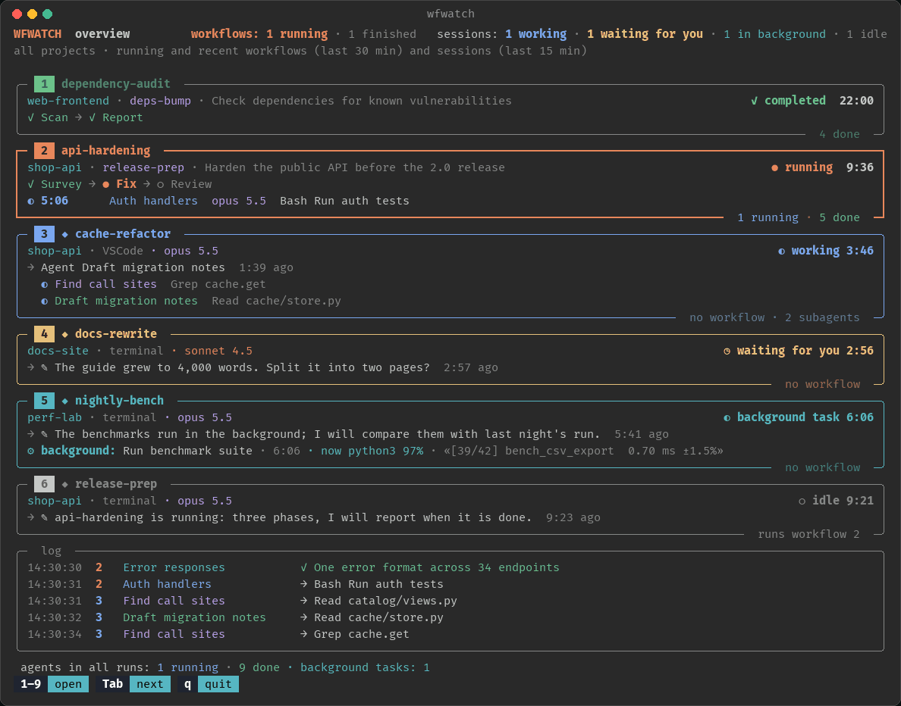
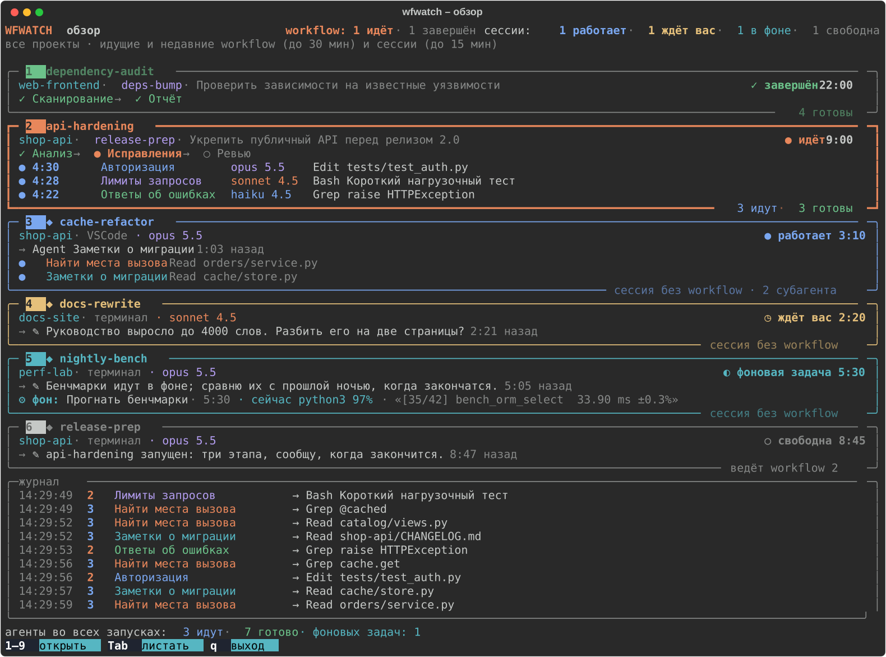
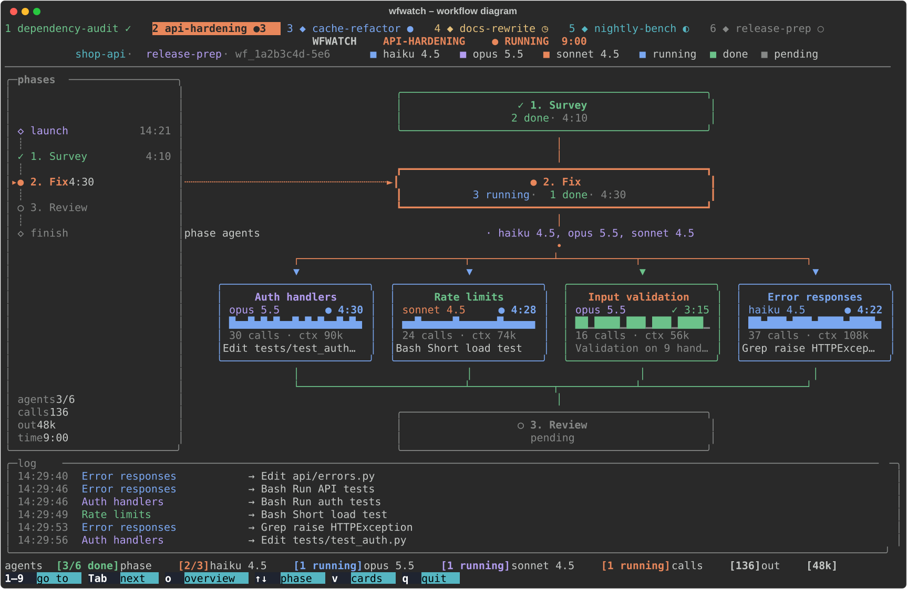
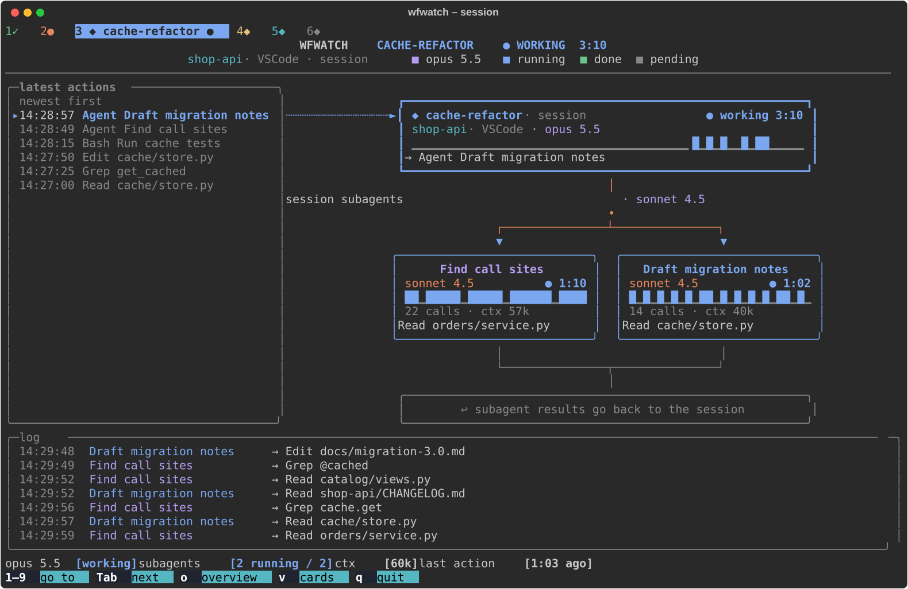

# wfwatch

[](https://github.com/zamirka/wfwatch/actions/workflows/ci.yml)
[](LICENSE)


Живая картина [workflow](https://code.claude.com/docs/en/workflows),
[субагентов](https://code.claude.com/docs/en/sub-agents) и сессий Claude Code в терминале.

[English version](README.md)

Workflow запускает десятки агентов по этапам, а ваши сессии тем временем работают в других
проектах. wfwatch показывает всё это в отдельном терминале: какие workflow идут, на каком этапе
каждый и что прямо сейчас делает каждый агент, какие сессии работают, ждут вашего ответа или
выполняют фоновую команду. Он только читает файлы, которые Claude Code и так пишет, поэтому ничего
не замедляет и не прерывает. Встроенный в Claude Code экран `/workflows` показывает запуски одной
сессии внутри неё самой; wfwatch следит сразу за всеми сессиями во всех проектах.

wfwatch – неофициальная утилита, она не связана с Anthropic и не одобрена ею (см.
[Оговорку](#оговорка)).



*Все снимки экрана сделаны на [синтетических демо-данных](#попробовать-на-демо-данных). На анимации и
на снимках схемы и сессии интерфейс на английском; ниже есть снимок обзора на русском.*

## Установка

Через [uv](https://docs.astral.sh/uv/):

```bash
uv tool install git+https://github.com/zamirka/wfwatch
```

или через [pipx](https://pipx.pypa.io/):

```bash
pipx install git+https://github.com/zamirka/wfwatch
```

Обновить: `uv tool upgrade wfwatch` или `pipx reinstall wfwatch`. Удалить:
`uv tool uninstall wfwatch` или `pipx uninstall wfwatch`.

Из клона репозитория:

```bash
git clone https://github.com/zamirka/wfwatch
cd wfwatch
python3 -m venv .venv
.venv/bin/pip install -e .
.venv/bin/wfwatch --version
```

Работает и `python -m wfwatch`.

## Запуск

Запускайте в отдельном терминале рядом с Claude Code:

```bash
wfwatch              # всё, что сейчас идёт; если идёт ровно один workflow – сразу его схема
wfwatch -o           # всё равно начать с обзора
wfwatch --list       # последние запуски: id, workflow, проект, сессия, состояние, агенты, время
wfwatch wf_1a2b      # один запуск по id или его началу (на другие не переключается)
wfwatch hardening    # один запуск по части названия workflow
wfwatch -c           # подробный вид карточками, а не схемой
wfwatch --once       # напечатать один кадр и выйти
```

Если ни один workflow и ни одна сессия не активны, wfwatch открывает последний запуск. Если запуск
не указан в командной строке, подробный вид workflow переключается на новый запуск, когда текущий
закончился. `wfwatch --help` перечисляет все параметры: `-n` (сколько запусков показать в
`--list`), `-a` (в карточках развернуть все этапы), `--width` (для `--list` и `--once`),
`--theme`, `--lang`, `--debug`, `--version`.

### Клавиши

| Клавиша | Что делает |
|---|---|
| `1`–`9` | открыть элемент с этим номером: сначала workflow, за ними сессии, как в обзоре. Две цифры подряд открывают элемент 10 и дальше |
| `o`, `0`, Esc | вернуться к обзору |
| Tab, → / Shift+Tab, ← | следующий / предыдущий элемент |
| Enter | в обзоре: открыть первый элемент |
| ↑ / ↓ | в workflow: предыдущий / следующий этап (вид перестаёт следить за идущим); в карточках сессии: прокрутка |
| `f` | в workflow: снова следить за идущим этапом |
| PgUp / PgDn, Home / End | в карточках: на страницу вверх или вниз, в начало, в конец |
| `v` | переключить схему и карточки |
| `a` | в карточках: развернуть все этапы или только активные |
| `q`, Ctrl+C | выход |

Внизу экрана строка клавиш, как в htop: в ней только то, что работает на текущем экране. Буквы
работают и в русской раскладке.

### Попробовать на демо-данных

Своих workflow пока нет? В репозитории есть генератор синтетических данных, все проекты и сессии
в нём выдуманные:

```bash
python3 scripts/demo_data.py /tmp/wfwatch-demo --live --lang ru   # около двух минут активности; Ctrl+C – остановить
CLAUDE_CONFIG_DIR=/tmp/wfwatch-demo wfwatch --lang ru             # в другом терминале
```

Агенты вызывают инструменты и завершаются, начинается следующий этап, workflow заканчивается,
фоновая команда печатает прогресс и завершается. Без `--live` скрипт записывает неподвижную
картину и выходит. `--lang ru` у скрипта – русские названия этапов, агентов и сообщений.

## Что на экране

### Обзор



Блок на каждый workflow: проект, сессия, состояние и время, цепочка этапов и строка на каждого
работающего агента с его моделью и последним действием. Видны идущие workflow и завершённые –
ещё 30 минут после конца. Ниже сессии (метка ◆): проект, VSCode или терминал, модель, сколько
сессия в своём состоянии, её последнее действие, работающие субагенты и фоновые команды. Сессия,
которая ведёт workflow, тоже здесь, с номером своего workflow. Сессия, которая ждёт вашего ответа,
выделена жёлтым, свободная – приглушена. Номера сквозные: сначала workflow, затем сессии. Внизу
общий журнал, у каждой строки номер её элемента.

Сессия видна, пока работает, ждёт вас, выполняет фоновую команду или агента, и ещё 15 минут после
того, как освободилась. Реестр сессий иногда держит сессию «занятой» ещё долго после остановки,
поэтому занятая сессия, в истории которой больше часа ничего не происходило (ждущая ответа – больше
трёх часов), не показывается.

Если терминал низкий и всё не помещается, сначала убираются строки агентов, затем блоки
сворачиваются в одну строку, а в конце строка говорит, сколько элементов не показано (до них
можно дойти клавишей Tab).

### Схема workflow



- Сверху: название, состояние и время, проект и сессия, цвета моделей.
- Слева: шкала от запуска до финиша, у каждого этапа его время.
- В центре: предыдущий этап, текущий и следующий. От текущего веером расходятся карточки агентов;
  те, что не поместились, свёрнуты в карточку «+N ещё». По связям бегут точки: синие – к работающим
  агентам, зелёные – обратно от завершённых.
- Карточка агента: модель, статус и время, ритм вызовов инструментов за всё время, число вызовов и
  размер контекста, последнее действие (у завершённого агента – первая строка результата). Агент,
  от которого больше трёх минут нет событий, помечен как «тишина».
- Снизу: журнал и строка статуса, например
  `агенты [3/6 готово]   этап [2/3]   opus 5.5 [1 идёт]   вызовов [136]   out [48k]`. В узком
  терминале идущие модели сворачиваются в один пункт (`3 модели [3 идут]`), затем пропадают вызовы и out.

Колонке этапов нужно от 100 колонок терминала; уже 70 колонок вместо схемы показываются карточки.
Схема подстраивается под размер терминала, от 80x24 до больших экранов.

### Карточки

`v` или `-c`: каждый этап – панель с карточками агентов. Идущие этапы, этапы с ошибками и выбранный
этап развёрнуты, остальные занимают по строке (`a` разворачивает все). PgUp/PgDn листают, если
этапы не помещаются. Если карточки этапа не помещаются на экране, карточки получают сначала идущие
агенты, затем агенты с ошибкой, а остальные показываются по строке.

### Сессия



Слева последние действия сессии (новые сверху), в центре блок сессии: состояние, модель, ритм
вызовов, последнее действие или сообщение. Субагенты сессии расходятся веером, как агенты этапа
workflow. У фоновых команд, идущих и недавно завершённых, свой блок. Снизу журнал сессии и её
субагентов и строка статуса:
`opus 5.5 [работает]   субагенты [2 идут / 2]   ctx [60k]   последнее действие [1:03 назад]`.

### Фоновые команды

Если сессия запустила долгую команду в фоне (инструмент Bash с `run_in_background`) и замолчала, она
не свободна: wfwatch показывает её как «◐ фоновая задача», с командой, временем работы, процессом,
который выполняется прямо сейчас, и его загрузкой процессора, а также с последней строкой вывода:

```
⚙ фон: Прогнать бенчмарки · 5:30 · сейчас python3 97% · «[35/42] bench_orm_select  33.90 ms ±0.3%»
```

Команда может писать вывод в свой файл (`blender -b scene.blend -a > render.log 2>&1`), и тогда
файл вывода Claude Code остаётся пустым. wfwatch спрашивает у системы, в какой файл пишет идущий
процесс, и показывает последнюю строку того из двух файлов, в который писали позже. У завершённой
команды виден код выхода.

### Состояния

| | Агент или этап | Workflow | Сессия |
|---|---|---|---|
| ● | идёт | идёт | работает |
| ✓ | готово | завершён | |
| ✗ | ошибка | ошибка | |
| ⚠ | прервано: запуск закончился или сессия закрылась раньше, чем агент вернул результат | | |
| ○ | ожидает или не запускался | | свободна |
| ↺ | заменён следующей попыткой после перезапуска (приглушён, не учитывается в счётчиках) | | |
| ■ | | остановлен или его сессия закрыта | |
| ◷ | | | ждёт вас |
| ◐ | | | фоновая задача |

В живом режиме у того, что работает прямо сейчас (агент, работающая сессия, фоновая команда), вместо ●
крутится ◐◓◑◒; в неподвижном кадре (`--once`, снимки экрана) – ●.

Процентов выполнения нет: агенты их не сообщают. О ходе работы говорят время, число вызовов, их ритм
и последнее действие.

## Как это работает

wfwatch читает файлы, которые Claude Code хранит в `CLAUDE_CONFIG_DIR` (по умолчанию `~/.claude`).
Чтобы смотреть другой каталог, задайте эту переменную.

| Источник | Что wfwatch из него берёт |
|---|---|
| `projects/<проект>/<сессия>.jsonl` | транскрипт сессии: запуски workflow и уведомления о завершении, фоновые команды и агенты, вызовы инструментов самой сессии |
| `projects/<проект>/<сессия>/subagents/workflows/<запуск>/journal.jsonl` | какие агенты запуска стартовали, вернули результат или завершились ошибкой |
| `projects/<проект>/<сессия>/subagents/workflows/<запуск>/agent-<id>.jsonl` | транскрипт агента: вызовы инструментов, модель, токены |
| `projects/<проект>/<сессия>/workflows/scripts/<имя>-<запуск>.js` | `meta` скрипта workflow: название, описание, этапы |
| `projects/<проект>/<сессия>/subagents/agent-*.jsonl` | обычные субагенты сессии |
| `sessions/<pid>.json` | работающие сессии: имя, статус, рабочий каталог, где открыта сессия |
| `/tmp/claude-<uid>/<проект>/<сессия>/tasks/<задача>.output` | вывод фоновых команд (последняя строка) |
| `ps` | жив ли процесс сессии, что прямо сейчас выполняет её инструмент Bash |
| `lsof` (macOS), `/proc/<pid>/fd` (Linux) | файл, в который фоновая команда пишет вместо своего файла вывода (`> render.log`): его последняя строка |

Транскрипты читаются по мере роста: только строки, добавленные с прошлого чтения, кусками, поэтому
длинная история обходится дёшево. Файлы перечитываются два раза в секунду, список запусков, сессии
и процессы – раз в три секунды. Отслеживаются запуски с активностью за последние три часа.

## Требования

- Python 3.10 или новее, macOS или Linux. В Windows запускайте wfwatch в WSL: полноэкранному режиму
  нужен POSIX-терминал. В «родной» Windows не проверялось.
- Терминал с UTF-8, 256 цветами или truecolor и шрифтом с символами рамок.
- От 100 колонок для полной схемы с колонкой этапов (на 80x24 тоже работает, в компактном виде).
- Claude Code. wfwatch проверен на Claude Code 2.1.311.

## Язык и цвета

Интерфейс на английском или русском: `--lang en|ru`, переменная `WFWATCH_LANG` или, если они не
заданы, локаль (`LC_ALL`, `LC_MESSAGES`, `LANG`: `ru_*` – русский). По умолчанию английский.

`--theme dark` подходит для тёмного фона терминала, `--theme light` – для светлого. По умолчанию
`auto`: тема выбирается по `COLORFGBG` (её задают многие терминалы), иначе тёмная. Основной текст
выводится цветом терминала. Если задана переменная `NO_COLOR`, цветов нет.

## Ограничения

- wfwatch читает внутренние файлы Claude Code. Их формат не документирован и может поменяться с
  любым обновлением. Если после обновления что-то перестало отображаться, откройте issue с выводом
  `wfwatch --version` и `claude --version`.
- Часть состояний определяется косвенно. Обычный субагент считается работающим, пока его транскрипт
  менялся за последние 90 секунд, фоновый – пока не пришло уведомление о его завершении. Сессия
  жива, пока жив её процесс (проверяются номер процесса и время его запуска), поэтому сессии из
  другого контейнера или с другой машины, которые пишут в тот же каталог, выглядят закрытыми.
  Фоновая команда, запущенная до перезапуска сессии, показывается как прерванная.
- Только эта машина и один `CLAUDE_CONFIG_DIR` за раз.

## Приватность

Всё остаётся на вашей машине. wfwatch читает перечисленные выше файлы и запускает `ps` (а на macOS
ещё `lsof`); он ничего не записывает, не открывает сетевых соединений и никуда ничего не
отправляет.

При этом на экране видно содержимое транскриптов: названия проектов и сессий, пути к файлам,
команды, поисковые запросы, адреса и первые строки того, что пишут агенты. Помните об этом, когда
показываете экран или делаете снимок. Для отчёта об ошибке безопаснее показать проблему на
демо-данных.

## Разработка

```bash
python3 -m venv .venv
.venv/bin/pip install -e '.[dev]'
.venv/bin/pytest -q
.venv/bin/ruff check . && .venv/bin/ruff format --check .
```

- `scripts/demo_data.py` пишет синтетический `CLAUDE_CONFIG_DIR`, описанный выше (`--help` –
  параметры, `--lang ru` – русское содержимое).
- `scripts/screenshots.py` делает из этих данных картинки в `docs/`: SVG – через Rich, GIF – через
  Pillow (`.venv/bin/pip install -e '.[demo]'`, затем `.venv/bin/python scripts/screenshots.py`).
  Часы и список процессов зафиксированы, поэтому при той же версии Rich SVG-файлы каждый раз
  получаются одинаковыми.

Стиль кода и то, как сообщить о проблеме, не раскрывая личных данных, описаны в
[CONTRIBUTING.md](CONTRIBUTING.md) (на английском), изменения – в [CHANGELOG.md](CHANGELOG.md).

## Оговорка

wfwatch – независимый неофициальный проект. Он не связан с Anthropic, не одобрен и не
поддерживается ею. Claude и Claude Code – товарные знаки Anthropic, PBC. wfwatch читает файлы,
которые Claude Code пишет для собственных нужд; их формат может измениться в любой версии
Claude Code.

## Лицензия

[MIT](LICENSE) © 2026 Zamir Musaev
